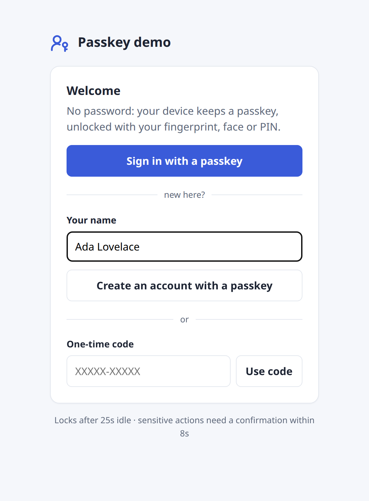
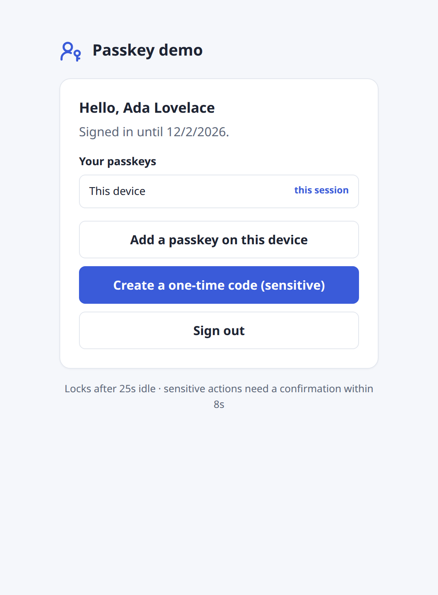
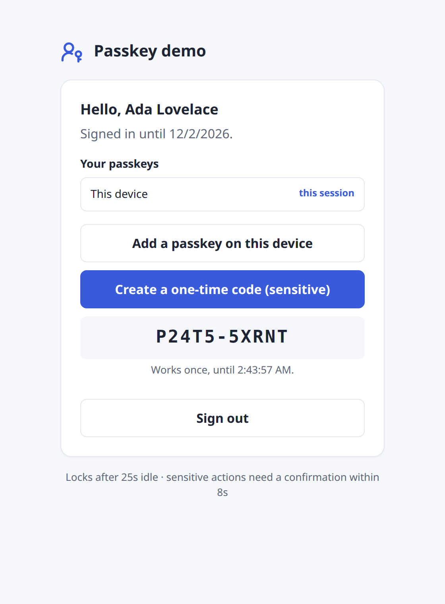
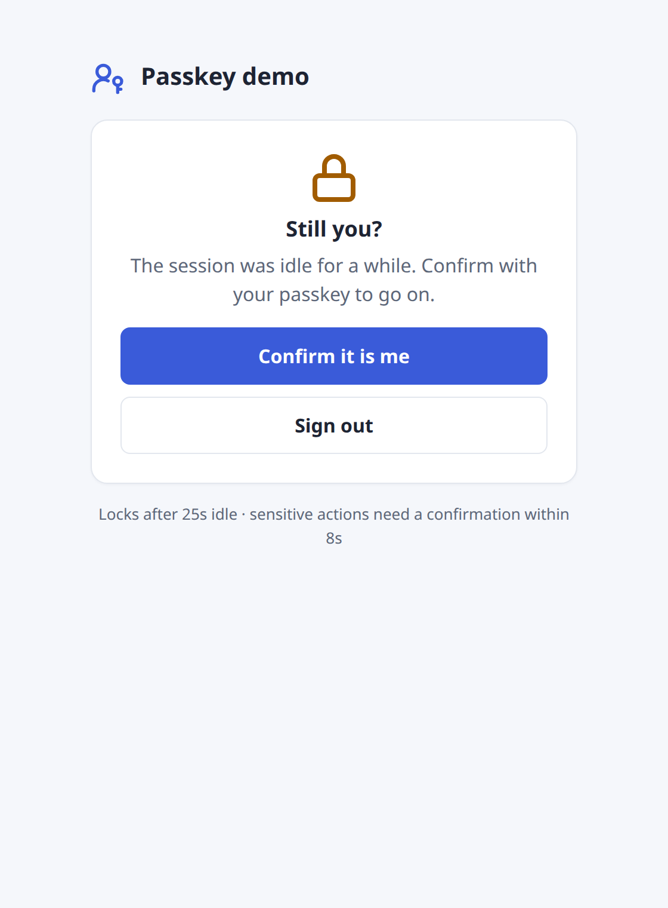
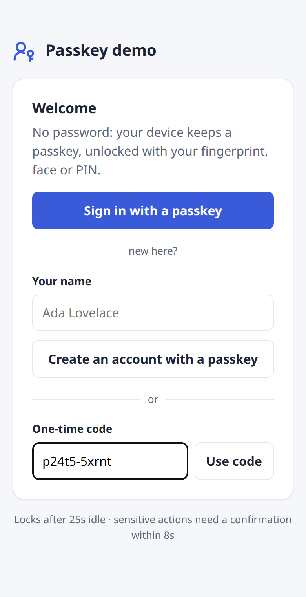

# passkey

**Passwordless sign-in with passkeys (WebAuthn) for Go + React web apps.**

People sign in with their fingerprint, face or device PIN. No passwords to store, leak or reset,
and nothing to phish. This library is the part every app rebuilds: the WebAuthn ceremonies, a session
cookie, "confirm it is you" for sensitive actions, and a way in for someone whose device cannot make
a passkey. Your app keeps its own users; the library only needs an id and a name for each.

- **Go package** on top of [go-webauthn](https://github.com/go-webauthn/webauthn): begin/finish
  registration, sign-in and confirmation, with discoverable credentials (nothing to type at sign-in).
- **Sessions** in an `HttpOnly` cookie; only a hash of the token is stored.
- **Step-up as configuration, not code**: lock a session after it sits idle for a set time, and name
  the actions that always need a fresh confirmation (`"device.add"`, `"member.approve"`, ...).
  Change that policy while the app runs, safely, with `SetPolicy`.
- **Stable error codes** (`passkey.reconfirm_required`, `passkey.confirmation_required`, ...) that
  the client acts on by itself.
- **One-time codes** for people whose device cannot make a passkey: expire, work once.
- **Storage is an interface**: an in-memory store and a GORM (PostgreSQL) store ship with it, and a
  conformance suite checks your own.
- **Gin** routes and middleware: `RequireSession`, `RequireFresh(action)`.
- **Go test helper** (`passkeytest`): a software passkey device, so your own tests can sign up, sign
  in and confirm without a browser.
- **TypeScript client** with `register()`, `signIn()`, `confirm()` and a React hook, on
  [@simplewebauthn/browser](https://simplewebauthn.dev).

| Sign up | Signed in | Sensitive action | Idle lock | Code on a phone |
|---|---|---|---|---|
|  |  |  |  |  |

The screenshots are the [demo](#run-the-demo), driven by a real browser with a virtual
authenticator.

## Contents

- [Install](#install)
- [Quick start](#quick-start)
- [How it works](#how-it-works)
- [Recipes](#recipes): [idle lock](#lock-a-session-after-it-sits-idle) ·
  [sensitive actions](#sensitive-actions) · [policy at run time](#change-the-policy-at-run-time) ·
  [one-time codes](#one-time-codes) ·
  [GORM storage](#gorm--postgresql-storage) · [custom storage](#your-own-storage) ·
  [cookie](#cookie-options) · [without Gin](#without-gin) · [test your app in Go](#test-your-app-in-go)
- [Options](#options) · [Error codes](#error-codes) · [Client API](#client-api)
- [Run the demo](#run-the-demo) · [Security notes](#security-notes)

## Install

Go (1.26 or newer):

```sh
go get github.com/ez-technologies/passkey@latest
```

npm, straight from GitHub (the built files are committed, so nothing is compiled on install):

```sh
npm install github:ez-technologies/passkey#v0.2.0
```

```ts
import { signIn } from '@ez-technologies/passkey'
import { usePasskey } from '@ez-technologies/passkey/react'
```

## Quick start

### Server

```go
package main

import (
	"time"

	"github.com/gin-gonic/gin"
	"github.com/google/uuid"

	"github.com/ez-technologies/passkey"
	"github.com/ez-technologies/passkey/ginpasskey"
	"github.com/ez-technologies/passkey/memstore"
)

func main() {
	svc, err := passkey.New(passkey.Config{
		RPID:    "example.com",                   // the domain passkeys belong to
		RPName:  "Example",                       // shown by the device
		Origins: []string{"https://example.com"}, // where the browser calls from

		ReconfirmAfter:   15 * time.Minute,                          // lock after 15 idle minutes
		SensitiveActions: []string{"passkey.add", "member.approve"}, // always need a fresh confirmation
	}, memstore.New())
	if err != nil {
		panic(err)
	}

	r := gin.Default()

	// The routes the client calls: register, login, confirm, code, session, logout.
	(&ginpasskey.Handlers{
		Service: svc,
		// Who a sign-up is for. Give the new account an id of your app (or refuse).
		NewUser: func(c *gin.Context, req ginpasskey.SignUp) (passkey.User, error) {
			return passkey.User{ID: uuid.NewString(), Name: req.Name, DisplayName: req.DisplayName}, nil
		},
	}).Mount(r.Group("/auth/passkey"))

	// Your API: signed in, not locked.
	api := r.Group("/api", ginpasskey.RequireSession(svc))
	api.GET("/me", func(c *gin.Context) {
		c.JSON(200, gin.H{"userId": ginpasskey.SessionFrom(c).UserID})
	})
	// A sensitive action: refused with passkey.confirmation_required unless the person confirmed recently.
	api.POST("/members/:id/approve", ginpasskey.RequireFresh(svc, "member.approve"), approveMember)

	r.Run(":8080")
}
```

### Browser (React)

```tsx
import { usePasskey } from '@ez-technologies/passkey/react'

export function Account() {
  const pk = usePasskey() // routes at /auth/passkey by default

  if (pk.status === 'loading') return null
  if (pk.status === 'locked') return <button onClick={pk.confirm}>Confirm it is you</button>
  if (pk.status === 'signed-out')
    return (
      <>
        <button onClick={pk.signIn}>Sign in with a passkey</button>
        <button onClick={() => pk.register({ name: 'ada', displayName: 'Ada' })}>Create an account</button>
      </>
    )

  // pk.fetch asks for the passkey when the server says a confirmation is needed, then retries.
  const approve = () => pk.fetch('/api/members/42/approve', { method: 'POST' })
  return (
    <>
      <p>Hello, {pk.user?.displayName}</p>
      <button onClick={approve}>Approve member</button>
      <button onClick={pk.signOut}>Sign out</button>
    </>
  )
}
```

Without React, the same functions are plain imports: `register()`, `signIn()`, `confirm()`,
`signOut()`, `getSession()`, `redeemCode()`, `fetchWithConfirmation()`.

## How it works

```
browser                                   server
  register({name})  ── register/begin ──▶  NewUser → BeginSignUp   (options + challenge id)
  device makes a passkey (fingerprint)
                    ── register/finish ─▶  FinishSignUp → StartSession   (Set-Cookie)
  signIn()          ── login/begin ─────▶  BeginLogin    (no user named: the device picks)
                    ── login/finish ────▶  FinishLogin → StartSession
  any API call      ─────────────────────▶ RequireSession ─ idle too long? ─▶ 401 reconfirm_required
                                           RequireFresh(a) ─ not fresh?    ─▶ 403 confirmation_required
  confirm()         ── confirm/begin ───▶  BeginConfirm  (only this person's passkeys)
                    ── confirm/finish ──▶  FinishConfirm (session active and fresh again)
```

- Every passkey is **discoverable** and needs **user verification**: sign-in asks for nothing typed,
  and the device always checks the person (fingerprint, face or PIN).
- A challenge lives `ChallengeTimeout` and works **once** (the store takes it in one step).
- A registration keeps **what it began for**: a sign-up (`BeginSignUp`, nobody signed in) or a
  passkey for the signed-in user (`BeginRegistration`). If that user's session ended between begin
  and finish, finish answers `passkey.session_required`; if it locked, `passkey.reconfirm_required`
  (confirm, then send the same finish again). It never turns into a sign-up.
- A sign-in whose signature counter did not go up (a copied passkey) is refused.
- Every failed sign-in has the same answer (`passkey.rejected`), so it tells nothing about who has
  a passkey.

## Recipes

### Lock a session after it sits idle

```go
passkey.Config{ ReconfirmAfter: 10 * time.Minute } // or time.Hour, 24 * time.Hour; 0 = never
```

A session not used for that long answers `401 passkey.reconfirm_required`. It is not over: the
person confirms with their passkey (`confirm()`, one fingerprint) and carries on where they were. In
React, `usePasskey().status` becomes `"locked"`; with plain fetch, `fetchWithConfirmation` does the
confirmation and the retry for you.

### Sensitive actions

Name them once in the configuration and guard the routes:

```go
cfg.SensitiveActions = []string{"device.add", "member.approve", "account.delete"}
cfg.FreshFor = 5 * time.Minute // a confirmation counts this long (default 5 minutes)

api.POST("/members/:id/approve", ginpasskey.RequireFresh(svc, "member.approve"), approve)
```

`RequireFresh` passes when the person signed in or confirmed within `FreshFor`, and otherwise
answers `403` with:

```json
{ "code": "passkey.confirmation_required", "action": "member.approve", "error": "confirm it is you to do this" }
```

An action name that is not in the list always passes, so routes can carry `RequireFresh` from day one
and the policy moves between "sensitive" and "not" in configuration alone. On the client:

```ts
await passkey.withConfirmation(() => approveMember(42)) // your function throws PasskeyError
const res = await fetchWithConfirmation('/api/members/42/approve', { method: 'POST' })
```

Adding and removing a passkey through the built-in routes check the actions
`ginpasskey.ActionAddPasskey` (`"passkey.add"`) and `ActionRemovePasskey` (`"passkey.remove"`):
list them to make those need a fresh confirmation too. In handlers of your own, call
`svc.CheckFresh(session, "action")`.

### Change the policy at run time

The idle lock and the sensitive actions start as `Config` and can be changed while the service runs,
for example when your administrators edit them in a settings screen. No rebuild, no restart:

```go
err := svc.SetPolicy(passkey.Policy{
	ReconfirmAfter:   30 * time.Minute,                     // 0 = never lock
	SensitiveActions: []string{"member.approve", "passkey.add"},
	FreshFor:         5 * time.Minute,                      // 0 = the default, 5 minutes
})
current := svc.Policy() // the policy in use (a copy)
```

`SetPolicy` replaces the whole policy at once and is safe to call from any goroutine while requests
run: each check reads one policy, the old or the new, never a mix. A negative duration is refused and
the policy in use stays. The new policy applies at each session's next request: a shorter
`ReconfirmAfter` locks a session already idle longer than it, and a newly sensitive action needs a
confirmation made within `FreshFor`. Middleware already mounted (`RequireSession`,
`RequireFresh(action)`) follows it. To keep the policy in your database, load it at start-up into
`Config` and call `SetPolicy` whenever it is saved (or on a timer, when several servers share it).

### One-time codes

For someone whose device cannot make a passkey, or who lost theirs. Who may create a code for whom is
your app's rule (an administrator, or the person on another signed-in device):

```go
code, expiresAt, err := svc.CreateCode(ctx, passkey.User{ID: userID, Name: "ada", DisplayName: "Ada"}, 24*time.Hour)
// code looks like "K7QMT-9XPRW": give it to the person
```

They type it on the sign-in page (`redeemCode(code)` → `POST /auth/passkey/code`); case, spaces and
dashes do not matter. It signs them in once, and from that session they can register a passkey with
`register()`. Only a hash of the code is stored. Put a rate limit in front of the route.

### GORM / PostgreSQL storage

```go
import "github.com/ez-technologies/passkey/gormstore"

store := gormstore.New(db) // db is your *gorm.DB
if err := store.Migrate(ctx); err != nil { ... } // or add gormstore.Models() to your own migrations
svc, err := passkey.New(cfg, store)
```

It keeps five tables, all named `passkey_*` (users, credentials, sessions, challenges, codes), next
to yours. The users table holds only the passkey identity of your users (your id, the WebAuthn handle
and a name); your own user table stays as it is. Challenges and codes are taken with
`DELETE/UPDATE ... RETURNING`, so two requests cannot use one. Expired sessions and challenges are
cleared as new ones are made, so there is no sweeper to run.

### Your own storage

Implement `passkey.Store` (users, credentials, sessions, challenges, codes; seventeen small
methods) on whatever database you have, then let the conformance suite check it:

```go
import "github.com/ez-technologies/passkey/storetest"

func TestMyStore(t *testing.T) {
	storetest.Run(t, func(t *testing.T) passkey.Store { return newEmptyStore(t) })
}
```

The suite checks every method, including that a challenge and a code can each be used by only one
of several requests racing for it.

### Cookie options

```go
cfg.Cookie = passkey.CookieConfig{
	Name:     "sid",                   // default "passkey_session"
	Path:     "/",                     // default "/"
	Domain:   "example.com",           // default: the host that set it
	SameSite: http.SameSiteStrictMode, // default Lax
	Insecure: false,                   // true drops Secure (plain HTTP on a host other than localhost)
}
cfg.SessionLifetime = 7 * 24 * time.Hour // default 30 days
```

The cookie is always `HttpOnly`. Browsers accept `Secure` cookies on `http://localhost`, so local
development works without `Insecure`. If the API is on another origin than the page, use
`SameSite: http.SameSiteNoneMode` and `credentials: 'include'` on the client.

### Without Gin

The `passkey.Service` methods take a `context.Context`, an `*http.Request` or an
`http.ResponseWriter`, so any router can call them; `ginpasskey` (one file) shows how.

```go
sess, err := svc.Session(ctx, r)                  // live session, or CodeSessionRequired / CodeReconfirmRequired
// Registration: a sign-up (nobody signed in) or a passkey for the signed-in user. Each finish holds
// to what its begin was for.
id, opts, err := svc.BeginSignUp(ctx, newUser)    // then svc.FinishSignUp(ctx, id, response, name)
id, opts, err = svc.BeginRegistration(ctx, user)  // then svc.FinishRegistration(ctx, id, sess.UserID, response, name)
err = svc.CheckFresh(sess, "member.approve")      // nil, or CodeConfirmationRequired
http.Error(w, err.Error(), passkey.HTTPStatus(err)) // 401 / 403 / 400 / 500
```

### Test your app in Go

`passkeytest` is a software passkey device for your own Go tests: no browser, no real authenticator.
`passkeytest.New(origin)` makes one (`origin` is one of `Config.Origins`); each `Authenticator` is
one device and keeps its passkeys.

```go
import "github.com/ez-technologies/passkey/passkeytest"

func TestApprove(t *testing.T) {
	ctx := t.Context()
	svc, _ := passkey.New(cfg, memstore.New())
	laptop := passkeytest.New("https://example.com")

	_, err := passkeytest.SignUp(ctx, svc, laptop, passkey.User{ID: "u1", Name: "ada"}) // BeginSignUp + FinishSignUp
	user, cred, err := passkeytest.SignIn(ctx, svc, laptop)                               // BeginLogin + FinishLogin
	sess, err := svc.StartSession(ctx, httptest.NewRecorder(), user.ID, cred.ID)
	err = passkeytest.Confirm(ctx, svc, laptop, sess)                                     // BeginConfirm + FinishConfirm
	_, err = passkeytest.Register(ctx, svc, passkeytest.New("https://example.com"), passkey.User{ID: "u1"}) // a second device
	// ...
}
```

Through HTTP (the `ginpasskey` routes or your own), the device answers the begin step's options
and you post its answer to the finish step:

```go
// POST register/begin (or login/begin, confirm/begin) answered {challengeId, options}
answer, err := laptop.Register(options) // laptop.SignIn(options) for login and confirm
// POST register/finish with {"challengeId": challengeId, "credential": answer}
```

The package documentation has a runnable example.

## Options

`passkey.Config`:

| Field | Default | Meaning |
|---|---|---|
| `RPID` | required | Domain the passkeys belong to (`example.com`). Changing it later means everyone registers again. |
| `RPName` | required | Name the device shows when it makes a passkey. |
| `Origins` | required | Full origins the browser calls from (`https://example.com`). |
| `Cookie` | see below | Session cookie: `Name` (`passkey_session`), `Path` (`/`), `Domain` (empty), `SameSite` (Lax), `Insecure` (false). Always HttpOnly. |
| `SessionLifetime` | 30 days | Most a session lives from sign-in. |
| `ReconfirmAfter` | 0 (never) | Idle time after which the session needs a passkey confirmation. Changeable with `SetPolicy`. |
| `SensitiveActions` | none | Action names that always need a fresh confirmation. Changeable with `SetPolicy`. |
| `FreshFor` | 5 minutes | How long a confirmation counts for sensitive actions. Changeable with `SetPolicy`. |
| `ChallengeTimeout` | 5 minutes | Time allowed between a ceremony's begin and finish. |
| `TouchEvery` | 1 minute | How rarely a session's last-active time is written (kept below `ReconfirmAfter`). |
| `CodeLength` | 10 | Characters in a one-time code (about 49 bits). |
| `Now` | `time.Now` | Clock, for tests. |

`ginpasskey.Handlers`:

| Field | Meaning |
|---|---|
| `Service` | The `*passkey.Service`. |
| `NewUser` | Who a sign-up is for: return a new `passkey.User` with your app's id, or an error to refuse. `nil` allows registration only for signed-in users. |
| `OnRegistered` | Runs after a passkey is stored (`created` is true for a sign-up); create your own user record here. An error undoes the passkey. |
| `OnSignIn` | Runs after any sign-in (passkey or code). |

Routes added by `Mount`:

| Route | Body → answer |
|---|---|
| `POST register/begin` | `{name?, displayName?}` → `{challengeId, options}` |
| `POST register/finish` | `{challengeId, credential, passkeyName?}` → `{user, signedIn}` |
| `POST login/begin` | → `{challengeId, options}` |
| `POST login/finish` | `{challengeId, credential}` → `{user}` |
| `POST confirm/begin` | → `{challengeId, options}` (works on a locked session) |
| `POST confirm/finish` | `{challengeId, credential}` → `{confirmedAt}` |
| `POST code` | `{code}` → `{user}` |
| `GET session` | → `{user, confirmedAt, expiresAt, hasPasskey}` |
| `GET credentials` | → `[{id, name, createdAt, lastUsedAt, current}]` |
| `DELETE credentials/:id` | → 204 (checks `passkey.remove`) |
| `POST logout` | → 204 |

## Error codes

Errors are [`apperr`](https://github.com/ez-technologies/apperr) errors: read the code with
`apperr.CodeOf(err)`. Answers are JSON `{"error": text, "code": code, ...}`.

| Code | Status | The client should |
|---|---|---|
| `passkey.session_required` | 401 | show sign-in |
| `passkey.reconfirm_required` | 401 | `confirm()`, then go on (idle lock) |
| `passkey.confirmation_required` | 403 | `confirm()`, then retry; `action` names the action |
| `passkey.rejected` | 401 | say the passkey was not accepted |
| `passkey.challenge_expired` | 400 | start the ceremony again |
| `passkey.invalid_code` | 401 | say the code is wrong, used or expired |
| `passkey.bad_request` | 400 | fix the request |

On the client, a closed passkey prompt is a `PasskeyError` with code `"cancelled"`.

## Client API

```ts
import {
  register, signIn, confirm, signOut, redeemCode, getSession,
  listPasskeys, removePasskey, withConfirmation, fetchWithConfirmation,
  createPasskeyClient, isSupported, PasskeyError, ErrorCodes, errorCode, needsConfirmation,
} from '@ez-technologies/passkey'
```

| Function | Does |
|---|---|
| `register({name?, displayName?, passkeyName?})` | Signed out: sign-up and sign-in. Signed in: adds a passkey. |
| `signIn()` | Sign-in; the device offers its accounts. |
| `confirm()` | Step-up: unlocks an idle session, makes the session fresh for sensitive actions. |
| `signOut()` | Ends this browser's session. |
| `redeemCode(code)` | Signs in with a one-time code. |
| `getSession()` | `{status: 'signed-in', session}`, `{status: 'signed-out'}` or `{status: 'locked'}`. |
| `listPasskeys()`, `removePasskey(id)` | The signed-in person's passkeys. |
| `withConfirmation(fn)` | Runs `fn`; on a confirmation error, `confirm()` and runs it once more. |
| `fetchWithConfirmation(input, init)` | The same around `fetch`, for your own API. |
| `createPasskeyClient(options)` | All of the above with the options bound. |

Every function takes `ClientOptions`: `baseUrl` (default `/auth/passkey`), `fetch`, `credentials`
(default `same-origin`), `headers`.

`usePasskey(options)` from `@ez-technologies/passkey/react` returns `status`
(`loading | signed-out | signed-in | locked`), `session`, `user`, `busy`, `error`, the actions
`register`, `signIn`, `confirm`, `signOut`, `redeemCode` (each resolves to `true` when it worked and
keeps `error` when it did not), plus `refresh`, `withConfirmation`, `fetch` and `client`.

## Run the demo

```sh
git clone https://github.com/ez-technologies/passkey && cd passkey
(cd client && npm ci && npm run build)
go run ./examples/demo -idle 1m -fresh 30s
```

Open <http://localhost:8080>: create an account, sign out and in, create a one-time code (a
sensitive action: after `-fresh` it asks for your passkey first), leave it idle past `-idle` to see
the lock, and use the code in a private window. Everything is kept in memory.

## Security notes

- Serve over HTTPS in production; `RPID` must be the site's domain or a parent of it.
- Rate-limit the routes, `code` above all.
- The cookie is `HttpOnly` and `SameSite=Lax` by default. If your API takes state-changing requests
  from other sites (`SameSite=None`), add CSRF protection.
- `NewUser` must return a new user: returning an existing user's id would let anyone add a passkey
  to that account. To add a passkey to an existing account, sign the person in first (passkey or
  one-time code) and call `register()`.
- Removing a passkey leaves sessions already signed in with it; call `svc.SignOutEverywhere(ctx, userID)`
  when it should end them.

## Licence

MIT
